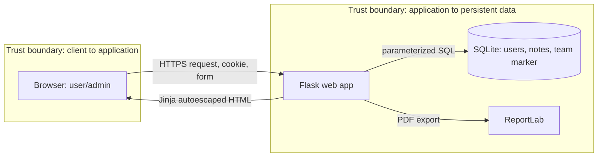

# NoteVault Secure Build Report

## Cover

| Field | Value |
|---|---|
| Team name | GLASS |
| Members (name + ID) | [Fill in all team members] |
| Target application | NoteVault, Flask + SQLite |
| Repository URL | https://github.com/march006/notevault-glass |
| Demo video (unlisted YouTube / Google Drive link) | [Add after recording; grant link access] |
| Date | 6 November 2026 |

## AI-tool usage disclosure

| Tool | How it was used |
|---|---|
| ChatGPT / Codex | Generated the initial app scaffold, vulnerable baseline, threat model draft, vulnerability mappings, remediation code, CI workflow, SBOM draft, and report draft. Team members must review, run, adapt, and be prepared to explain every change. |

## 1. Executive Summary

NoteVault is a small Flask note-sharing app. The intentionally vulnerable baseline has eight findings: six High and two Medium. The most serious risks are SQL injection, broken access control, and stored XSS. The remediated build uses parameterized SQL, owner-scoped reads, Jinja escaping, password hashing, CSRF protection, secure session handling, pinned runtime dependencies, and a non-root hardened container. Residual risks include no production rate limiter or audit trail. The CI gate is configured, but no GitHub Actions run has completed yet, so the build and signed release are not verified.

## 2. System Scope & Function

The app supports registration and login, creating and viewing personal notes, searching notes, an administrator user list, and PDF export. In scope are browser-to-Flask requests, cookie sessions, SQLite storage, the PDF export function, Python dependencies, Docker image, and GitHub Actions. The vulnerable baseline is isolated under `project/vulnerable-baseline`; the fixed implementation is `project/starter-app`.

### Data-Flow Diagram

`TEAM_ID=GLASS` seeds a deterministic traceability marker in the `team_marker` table and displays it in the app. The marker is evidence for this team build, not a credential.

## 3. Threat Model — STRIDE

| Element / data flow | S | T | R | I | D | E | Top threat & mitigation |
|---|---|---|---|---|---|---|---|
| Browser ↔ Flask session and forms | Credential/session spoofing | Forged note or login request | User disputes note change | Cookie or note disclosure | Request flooding | Role escalation | Hash passwords, rotate session, HttpOnly/SameSite/Secure, CSRF tokens, role gate, bounded input |
| Flask ↔ SQLite | N/A | SQL injection or unauthorized update | No audit trail | Cross-user note read | Expensive query | Database role abuse | Parameterized SQL, owner_id in every note query, bounded search, add audit trail before production |
| Flask → PDF export | N/A | Malformed export input | No export audit | Another user's note exported | Large export | N/A | Owner-scoped note lookup and request-size limits |
| Build workflow → artifact | Compromised action/dependency | Tampered build or SBOM | Weak provenance | Secret leakage | Resource exhaustion | Artifact substitution | Scan dependencies, secret scan, short-lived OIDC signing, retain workflow identity and commit SHA |

### Top 5 risks ranked by likelihood × impact

| Rank | Risk | Likelihood | Impact | Mitigation |
|---|---|---|---|---|
| 1 | SQL injection in baseline search | High | High | Parameterized query; SAST/SCA gate |
| 2 | IDOR / missing authorization on note and export | High | High | Owner-scoped access checks and admin decorator |
| 3 | Stored XSS in note display | Medium | High | Template autoescaping; no raw HTML rendering |
| 4 | Plaintext credentials and fixed session signing key | Medium | High | Strong password hashes; required random secret; rotate session |
| 5 | Vulnerable dependencies and root container | Medium | High | Pinned direct dependencies, audit gate, non-root container, SBOM and signing |

## 4. Vulnerability Findings

Severity is qualitative for the local teaching app. Reproduce only against the deliberately vulnerable local baseline with dummy data.

### Finding F-01 — SQL injection in search

- **CWE:** CWE-89. **OWASP 2025:** A05 Injection. **Severity:** High.
- **Location:** `project/vulnerable-baseline/app.py`, `/search`.
- **Reproduction:** Start the baseline and request `/search?q=%25%27%20OR%201%3D1%20--%20`. The formatted SQL changes its predicate.
- **Impact:** Search may return records outside the intended query.
- **Evidence:** Source line builds SQL using string formatting; preserve a local request/response screenshot when you record the demo.

### Finding F-02 — Broken access control / IDOR

- **CWE:** CWE-639. **OWASP 2025:** A01 Broken Access Control. **Severity:** High.
- **Location:** Baseline `/export/<id>` and `/note/<id>`.
- **Reproduction:** Request `/export/1` without a session, then change the numeric ID to another seeded note.
- **Impact:** Unauthorized note disclosure.
- **Evidence:** Baseline handlers load by id without owner verification; capture the response locally.

### Finding F-03 — Stored cross-site scripting

- **CWE:** CWE-79. **OWASP 2025:** A05 Injection. **Severity:** High.
- **Location:** Baseline `/note` and `/note/<id>`.
- **Reproduction:** Sign in to the local baseline, POST title `Demo` and body `` to `/note`, then open the saved note.
- **Impact:** Script executes in a viewer's browser origin.
- **Evidence:** Baseline passes stored title/body into `render_template_string` as HTML; capture browser behavior.

### Finding F-04 — Plaintext passwords and known demo admin credential

- **CWE:** CWE-256, CWE-521. **OWASP 2025:** A04 Cryptographic Failures and A07 Authentication Failures. **Severity:** High.
- **Location:** Baseline `users` schema and `/login`; seeded account `admin / admin123`.
- **Reproduction:** Sign in locally using the seeded demo credential or inspect the SQLite `users` table.
- **Impact:** Password disclosure and administrator account takeover.
- **Evidence:** Baseline stores the password field directly and embeds a known development password.

### Finding F-05 — CSRF on note creation

- **CWE:** CWE-352. **OWASP 2025:** A01 Broken Access Control. **Severity:** Medium.
- **Location:** Baseline POST `/note`.
- **Reproduction:** While signed in, submit a cross-origin form POST to `/note`; the route has no CSRF token.
- **Impact:** A victim's browser can create an unintended note using the active session.
- **Evidence:** Baseline form and handler contain no CSRF check; record a local request/response.

### Finding F-06 — Fixed session signing key and weak cookie policy

- **CWE:** CWE-384, CWE-1275. **OWASP 2025:** A07 Authentication Failures and A02 Security Misconfiguration. **Severity:** Medium.
- **Location:** Baseline Flask initialization and cookie defaults.
- **Reproduction:** Inspect the hard-coded `app.secret_key='dev-secret'` and cookie response flags.
- **Impact:** A known signing secret enables session forgery; weak cookie attributes increase theft/fixation risk.
- **Evidence:** Baseline source shows the fixed key; capture `Set-Cookie` flags for the demo record.

### Finding F-07 — End-of-life dependencies

- **CWE:** CWE-1104. **OWASP 2025:** A03 Software Supply Chain Failures. **Severity:** High.
- **Location:** `project/vulnerable-baseline/needs-vulnerable.txt` and Python 3.7 baseline image.
- **Reproduction:** In a disposable environment run `pip-audit -r project/vulnerable-baseline/needs-vulnerable.txt` and inspect the old pinned packages.
- **Impact:** Known vulnerable components can enable compromise.
- **Evidence:** Obsolete versions are explicitly pinned in the baseline; retain scanner output when available.

### Finding F-08 — Insecure Docker build configuration

- **CWE:** CWE-250, CWE-1104. **OWASP 2025:** A02 Security Misconfiguration and A03 Software Supply Chain Failures. **Severity:** High.
- **Location:** Baseline Dockerfile.
- **Reproduction:** Inspect the end-of-life Python base, root user, and broad build context.
- **Impact:** Known runtime issues and unnecessary container privileges increase compromise impact.
- **Evidence:** Dockerfile uses Python 3.7 and runs as root.

## 5. Remediation

| Finding | Vulnerable → fixed implementation | Why this fixes it | Commit |
|---|---|---|---|
| F-01 | String-formatted SQL → parameterized SQLite query | User input stays data, not SQL syntax | `fe38f23` |
| F-02 | ID-only lookup → owner-scoped note/export query and admin decorator | Each request checks the authenticated owner or role | `fe38f23` |
| F-03 | Raw HTML concatenation → Jinja autoescaping | HTML metacharacters render as text | `fe38f23` |
| F-04 | Plaintext/default credential → Werkzeug password hashes; environment-provided admin password | Stored values are one-way hashes; no shipped production password | `fe38f23` |
| F-05 | No CSRF token → per-session token on all state-changing forms | Cross-site requests lack the valid token | `fe38f23` |
| F-06 | Fixed signing key → required secret, session rotation, HttpOnly/SameSite and Secure-on-HTTPS | Attackers cannot derive signing key from source; cookie handling improves | `fe38f23` |
| F-07 | Old pins → maintained pinned direct dependencies, pip-audit gate, CycloneDX SBOM | Known dependency advisories fail the workflow | `db621ff` |
| F-08 | Root/EOL image → patch-version slim image, non-root UID, read-only FS, dropped capabilities | Reduces known vulnerable base exposure and runtime privilege | `db621ff` |

Attach before/after request screenshots and exact line diffs during the team's local demo; this draft does not fabricate exploit output.

## 6. Supply-Chain Hardening

- **SBOM:** `project/starter-app/sbom.cdx.json` is CycloneDX 1.6 and currently lists 4 direct runtime components. GitHub Actions regenerates a dependency-resolved SBOM from `needs.txt`; update the component count from that workflow artifact before submission.
- **Signing:** The workflow uses GitHub OIDC with Cosign to sign the image archive and attest the SBOM. A signed artifact has not yet been produced because no workflow run has completed. Attach the actual `cosign verify-blob` and `cosign verify-attestation-blob` output after a successful run.
- **SLSA self-assessment:** This build does not claim SLSA conformance yet. CI runs in GitHub Actions and signatures bind artifacts to a short-lived workflow identity, but the workflow does not currently generate a SLSA provenance predicate or meet a hardened builder isolation profile. Add provenance generation and verify builder identity before claiming a SLSA level.

## 7. Security CI Pipeline

Workflow: [`.github/workflows/security.yml`](https://github.com/march006/notevault-glass/blob/main/.github/workflows/security.yml). Bandit runs SAST, pip-audit runs SCA, and Gitleaks scans secrets on push and pull request. Bandit `-ll` fails on medium/high findings; pip-audit fails on reported vulnerabilities; Gitleaks fails on secrets. The supply-chain job builds and signs release material on pushes to `main`.

- **High/critical failure screenshot:** [Add after a controlled CI run; no GitHub Actions run exists yet.]
- **Successful run and signed artifact:** [Attach Actions run URL and uploaded artifact bundle after it completes.]

## 8. Conclusion & Reflection

The fixed build narrows the main trust-boundary risks with parameterized queries, per-object authorization, output escaping, authenticated state changes, and hardened packaging. Residual production work includes TLS proxy deployment settings, rate limits, audit logging, encrypted backups, dependency lock/verification, and a signed provenance attestation. Team members should document what they learned after reproducing the attacks and reviewing the fixes.

## Appendix

- **Tools:** Git, Docker Compose, Bandit, pip-audit, Gitleaks, CycloneDX, Cosign. Add versions and actual execution results.
- **References:** [OWASP Top 10 2025](https://top10.owasp.org/2025/); [CWE](https://cwe.mitre.org/); [Sigstore Cosign](https://docs.sigstore.dev/cosign/).
- **Task split:** [Fill in each member's actual contribution and private peer assessment; do not invent names or ratings.]
