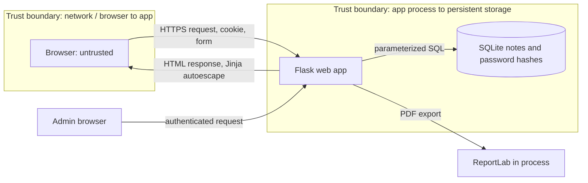

# NoteVault Secure Build Report

## Cover
- Team: **[TEAM_ID]**
- Members: **[names and roles]**
- GitHub repository: **[add repository URL]**
- Unlisted demonstration video: **[add YouTube or Drive URL with link access enabled]**
- Submission date: **6 November 2026, 16:59 ICT**

## Executive summary
NoteVault is a deliberately scoped Flask notes application. This report describes the assets and trust boundaries, the security findings in the vulnerable baseline, the remediations in the secure build, and reproducible supply-chain controls. Only run attack demonstrations against the local lab instance.

## 1. Threat model
### Scope and assumptions
Local web app on port 8080; SQLite persistence; a browser is untrusted; reverse proxy/TLS termination is outside the demo. Users may be malicious. Production secrets and public deployment are out of scope.
### Data-flow diagram

### STRIDE analysis
| Threat | Component / boundary | Example | Control |
|---|---|---|---|
| Spoofing | Login boundary | Credential guessing or stolen cookie | Strong password hashes, secure cookie flags, rotate session at login |
| Tampering | Forms to app | Cross-site note creation or forged fields | CSRF token, server-side validation |
| Repudiation | App and audit trail | User denies changing a note | Authenticated owner_id; production audit logging remains recommended |
| Information disclosure | Notes / export | IDOR exposes another user's note | Owner-scoped queries, admin gate, no secret in source |
| Denial of service | Request / export | Oversized content or expensive repeated requests | 1 MiB request cap, field bounds; production rate limit still required |
| Elevation of privilege | User to admin | Role supplied by registration or stale session | Role assigned server-side, decorator authorization |

## 2. Vulnerability report
Severity uses CVSS-like qualitative ratings for this teaching app; exploitability is local and assumes an authenticated or reachable instance.
| ID | Finding and severity | Reproduction in vulnerable baseline | CWE | OWASP Top 10:2025 | Impact |
| F-01 | SQL injection in search — High | Open `/search?q=%25'%20OR%201%3D1%20--%20` in baseline; SQL is assembled with string formatting | CWE-89 | A05 Injection | Reads notes outside the intended search predicate |
| F-02 | Broken access control / IDOR — High | Change `/export/1` to another user's note id | CWE-639 | A01 Broken Access Control | Unauthorized note disclosure |
| F-03 | Stored XSS — High | POST an `` title/body to `/note`, then open `/note/1` | CWE-79 | A05 Injection | Script executes in readers' sessions |
| F-04 | Weak password storage / demo default — High | Inspect SQLite hash/plaintext or log in with seeded admin credentials | CWE-256, CWE-521 | A07 Authentication Failures | Account takeover and administrator compromise |
| F-05 | CSRF on state changes — Medium | POST `/note` has no CSRF token; submit a forged cross-origin request while logged in | CWE-352 | A01 Broken Access Control | Forged actions using victim's session |
| F-06 | Session fixation and weak cookie policy — Medium | Inspect static signing key and missing SameSite/Secure flags; session identity is not regenerated after login | CWE-384, CWE-1004 | A07 Authentication Failures | Session theft or fixation |
| F-07 | Dependency vulnerabilities / obsolete pins — High | `pip-audit -r needs-vulnerable.txt`; review affected transitive dependencies | CWE-1104 | A03 Software Supply Chain Failures | Known public CVEs can enable compromise |
| F-08 | Insecure container build — High | Inspect baseline Dockerfile for an end-of-life Python base, root user and broad build context | CWE-250, CWE-1104 | A02 Security Misconfiguration | Known runtime flaws and unnecessary container privileges increase impact |

## 3. Remediation mapping
| Finding | Secure implementation |
|---|---|
| F-01 | Parameterized SQLite queries; wildcard input bounded |
| F-02 | Owner-scoped read/export; admin decorator checks server-side role |
| F-03 | Jinja autoescaping; no string-built HTML |
| F-04 | Werkzeug password hashes; registration requires 12+ chars; no default production password |
| F-05 | Per-session CSRF token on all state-changing forms |
| F-06 | HttpOnly and SameSite=Lax; session cleared and rotated at login; Secure enabled behind HTTPS |
| F-07 | Current pinned dependencies, pip-audit failure gate, CycloneDX SBOM |
| F-08 | Pinned slim base, non-root UID, read-only root FS, dropped capabilities, no-new-privileges, no baked secrets |

## 4. Secure build and supply chain
- SBOM: `sbom.cdx.json` in CycloneDX JSON format generated from `needs.txt`.
- Container: multi-stage build is unnecessary for this small app; the runtime image uses a non-root account and only copies runtime files.
- Signing: GitHub Actions requests short-lived Sigstore identity via OIDC; signs the image archive and attests the SBOM. Verify with `cosign verify-blob` and `cosign verify-attestation-blob` using the workflow identity and issuer constraints.
- Provenance: GitHub workflow run, commit SHA, and artifact bundles are uploaded with the build. Protect `main` and require successful `scans` before merge.

## 5. Security CI
GitHub Actions runs Bandit (SAST), pip-audit (SCA), and Gitleaks secret scanning on pushes and pull requests. Any Bandit medium/high finding (`-ll`), any pip-audit vulnerability, or detected secret fails the job. Main-branch build creates SBOM, builds and signs artifact material.

## 6. Attack, root cause, fix demonstration
For each finding: show the vulnerable behavior in the baseline, identify the unsafe data flow or missing authorization check, switch to the secure implementation, replay the same request, and show the denied/escaped/isolated outcome. Do not include real credentials or expose the app publicly.

## 7. Limitations and residual risks
This classroom app has no production rate limiting, password reset, email verification, audit log, backup encryption, TLS proxy configuration, or formal authorization review. Set `COOKIE_SECURE=1` behind HTTPS, inject random secrets from a secret manager, and review dependency/image scans at release time.

## 8. Individual contribution (submit privately)
| Member | Contribution | Assessment |
|---|---|---|
| [Name] | [specific work] | [Full / Most / Some / Little + reason] |
| [Name] | [specific work] | [Full / Most / Some / Little + reason] |

## Appendix: run locally
Set `TEAM_ID` once and retain it. Set strong `SECRET_KEY` and `ADMIN_PASSWORD`, then run `docker compose up --build` from `project/starter-app`. Demo credentials are not published; create a user through registration. This PDF is a starter report; replace bracketed team/repo/video fields and enter truthful contribution statements before submission.

## References
- [OWASP Top 10 2025](https://top10.owasp.org/2025/)
- [OWASP A01 Broken Access Control](https://top10.owasp.org/2025/A01_2025-Broken_Access_Control/)
- [OWASP A05 Injection](https://top10.owasp.org/2025/A05_2025-Injection/)
